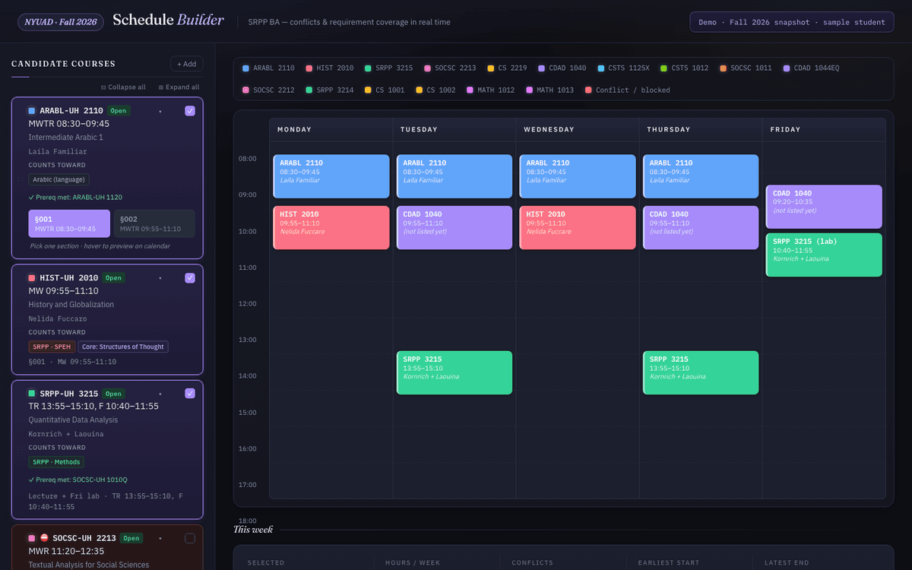
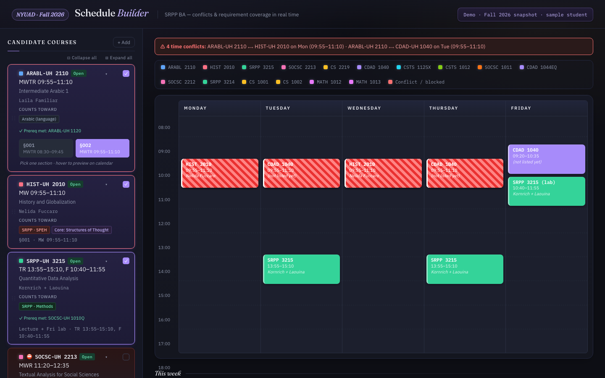
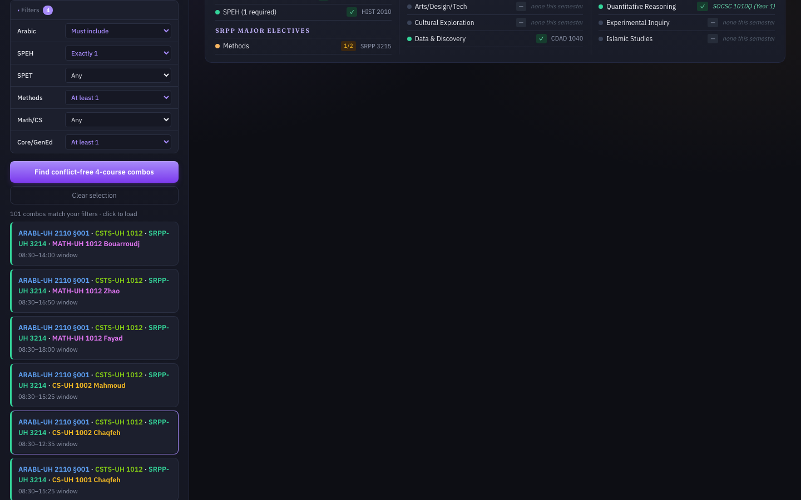
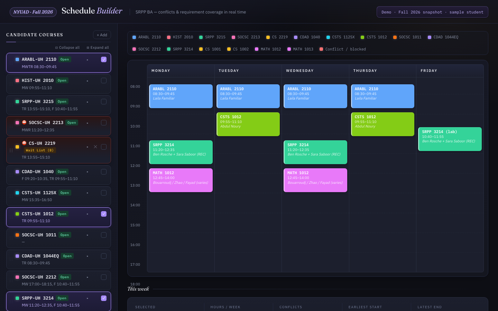

# Smart Schedule Synth

**A course-schedule builder for NYU Abu Dhabi that puts sections, prerequisites, and degree requirements on one screen.**

**▶ Live demo: https://hawever-renbo.github.io/smart-schedule-synth/** (single HTML file, no install, no login)

## Why I built it

Picking classes at NYUAD means juggling three systems that don't talk to each other:

| What you need | Where it lives |
|---|---|
| Sections, meeting times, open seats | **Albert** (NYU's registration system, behind SSO) |
| Course descriptions, prerequisites, syllabi | **Student Portal** course list |
| Which courses count toward your major and the Core | **Bulletin / major brochure** |

So every "can I take X?" question becomes three tabs, a spreadsheet, and a hand-drawn week grid. This tool merges all three into one view and answers the questions directly: does this clash, am I allowed to take it, and what does it move forward in my degree?

## v1 → v2

- **v1 (Oct 2025, NYUAD hackathon):** a Flask app with 31 Fall 2025 courses, conflict detection, and LLM-suggested alternative sections. Code kept as-is in [`v1-hackathon/`](v1-hackathon/).
- **v2 (Apr 2026, my own follow-up):** I kept building on the idea after the hackathon and used it for my real Fall 2026 registration. v2 is a single self-contained page ([`docs/index.html`](docs/index.html)) built around one student's actual degree:
  - **Week grid with live conflict detection.** Hover a section to preview it on the calendar before committing.
  - **Prerequisite checker** against the student's completed courses, which flags anything you can't self-enroll in.
  - **Requirement-coverage tracker** for the full SRPP BA, Common Core, and Gen Ed: what's already done, what this semester adds, and what's still open.
  - **Combo explorer**, which enumerates every 4-course plan and keeps the ones that are conflict-free and prereq-clean, with degree-aware filters (e.g. "must include Arabic", "exactly one SPEH", "at least one Methods").
  - **Paste-to-add:** paste a course's raw text from Albert, and a small parser (optionally assisted by an LLM) turns it into a card. API keys stay in your browser's localStorage.
  - Collapse, hide, and drag-reorder cards. State persists locally.

| Conflict detection | Degree-aware combo explorer | Plan loaded, no conflicts |
|---|---|---|
|  |  |  |

## Run it

Open `docs/index.html` in any browser. That's it. The course list and the `USER_COMPLETED` / `PRIOR_SATISFIED` blocks near the top of the script are plain data, so you can edit them to match your own record.

## Privacy

The public demo uses a **fictional sample student**. Before publishing I removed my transcript, my enrollment appointment, Albert class numbers, an instructor-permission record, and all peer course reviews (they came from a private student group). Course titles, times, and instructors are from NYUAD's public Fall 2026 listings as of April 2026 and may have changed since.
